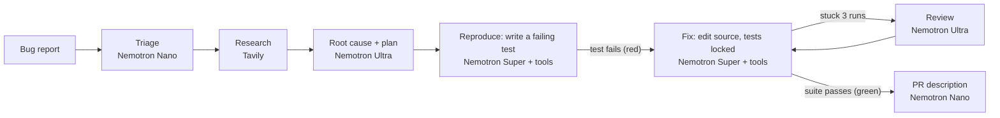

# Fixpoint

**Bug report in, failing test, green suite.** Fixpoint is a test-first bug-fixing agent built on NVIDIA Nemotron
models served by Nebius Token Factory. Give it a repository and a bug report (or a GitHub issue URL). It writes a
test that reproduces the bug, proves the test fails, fixes the code until the whole suite passes, and hands back a
patch plus a pull request description.

*Track: Coding and Agentic Engineering.*

## Why

Coding agents produce patches that are hard to trust. "I fixed it" is a claim, and the usual evidence is the
agent's own say-so. Fixpoint only reports success when a test that failed before the change passes after it, and the
agent cannot edit that test while it fixes the code. The test it leaves behind also keeps the bug from coming back.

## How it works



1. **Triage (Nano).** Reads the report and the file tree, then picks suspect files, search keywords and a web
   query. Stack-trace frames in the report are mapped to repository files deterministically.
2. **Research (Tavily).** Searches the web the way an engineer would before touching the code: the exact error
   message, or the language/library behaviour behind the bug (for example Python's rounding rules). If triage gives
   no query, the bug's symptom is searched. Tavily's answer and sources go into Ultra's plan, the agents can call
   `web_search` again while they work, and every source consulted is cited under "References" in the PR
   description.
3. **Plan (Ultra).** Reads the relevant source and writes a root cause, the expected behaviour, a test plan and a
   fix plan.
4. **Baseline.** Runs the existing suite so Fixpoint knows what "green" means for this repository.
5. **Reproduce (Super, tool loop).** Only test files are writable in this phase. Super reads code, writes a new test
   and runs it. When it calls `finish`, Fixpoint re-runs the test itself and accepts only a real assertion failure:
   a passing test, or a test that errors on import or syntax, is sent back.
6. **Fix (Super, tool loop).** Test files are now locked, so the agent cannot make the suite green by weakening the
   test. Super edits source and runs the suite. After 3 red runs in a row, Ultra reviews the diff and test output and
   gives targeted advice (at most twice). `finish` is only accepted after Fixpoint re-runs the whole suite and it
   passes.
7. **Report (Nano).** Writes the pull request description from the plan, the diff and the verified outcome.

Every test run happens in a sandbox: a Docker container with no network, 1 CPU, 1 GB RAM and a process limit, or a
local subprocess with API keys and other secrets stripped from its environment.

## How NVIDIA Nemotron is used

Fixpoint routes each call to the smallest Nemotron model that does the job well:

| Tier | Model (Token Factory ID) | Used for | Why |
| --- | --- | --- | --- |
| Nano | `nvidia/NVIDIA-Nemotron-3-Nano-30B-A3B` | Triage, PR write-up | Short structured JSON and prose; fast and cheap |
| Super | `nvidia/nemotron-3-super-120b-a12b` | Both tool-calling agent loops | Most of the calls; native function calling at a mid price |
| Ultra | `nvidia/Nemotron-3-Ultra-550b-a55b` | Root-cause planning, escalation reviews | The few calls where deep reasoning decides whether the run succeeds |

By design, Nano is called twice per run (triage and the write-up), Ultra once plus at most two escalation reviews,
and Super once per step of the two agent loops. The UI and CLI show tokens per tier and an estimated cost per fix.

The agent loops use the OpenAI-style `tools` API natively. Reasoning output (`<think>` blocks or a separate
`reasoning_content` field) is captured and shown in the UI. If an endpoint ever rejects the `tools` parameter,
Fixpoint switches to a text tool-call protocol (`<tool_call>{...}</tool_call>`) automatically.

## Where Token Factory helped

- **One endpoint, three model sizes.** Nano, Super and Ultra sit behind the same OpenAI-compatible API, so routing a
  call to a different tier is a one-string change (`fixpoint/llm.py`), and any tier can be swapped with an
  environment variable.
- **No infrastructure to run.** The 550B Ultra model is available on demand, so the planner and escalation path can
  use it for only a handful of calls per run.
- **Token usage on every response.** This drives the per-tier accounting and the cost estimate shown after each fix.

## Other Nebius services

- **Nebius Serverless Endpoints**: the Docker image is built to run as one (see
  [Deploy](#deploy-to-a-nebius-serverless-endpoint)); the container itself is the sandbox for test runs there.

## Quick start

Requires Python 3.10+ and git. Docker is optional (it is used for sandboxed test runs).

```bash
git clone <this repository> fixpoint && cd fixpoint
python -m venv .venv
# Windows: .venv\Scripts\activate    macOS/Linux: source .venv/bin/activate
pip install -e .
cp .env.example .env      # then put your NEBIUS_API_KEY (and optionally TAVILY_API_KEY) in .env
fixpoint check            # verifies the key, the Nemotron model IDs, Tavily and the sandbox
```

Optional but recommended, the Docker sandbox:

```bash
docker build -f sandbox.Dockerfile -t fixpoint-sandbox .
```

### Web app

```bash
fixpoint serve            # http://127.0.0.1:8000
```

Pick an example bug, press **Fix it**, and watch the run: phases, every model call with its tier and tokens, tool
calls, red and green test runs, the Ultra review if it is needed, and finally the patch and the PR description.

### Command line

```bash
fixpoint run --repo scheduler                      # bundled example; its ISSUE.md is the bug report
fixpoint run --repo billing --out out/             # also writes out/fix.patch, out/PR.md, out/report.json
fixpoint run --repo path/to/your/project --issue-file bug.md
fixpoint run --issue https://github.com/OWNER/REPO/issues/123          # clones the repo, reads the issue
fixpoint run --repo ../my-js-app --issue "..." --test-cmd "npm test --silent"
```

The exit code is 0 only when the fix is verified.

### Bundled examples

| Example | Bug | What makes it interesting |
| --- | --- | --- |
| `scheduler` | Subscriptions starting on the 31st crash with `ValueError: day is out of range for month` | Stack trace to file mapping; month-end clamping |
| `billing` | Tax of $0.125 rounds to $0.12 instead of $0.13 | Needs outside knowledge: Python's `round()` rounds half to even and works on binary floats; the expected fix is `Decimal` with `ROUND_HALF_UP` |
| `ratelimit` | A 5-per-second limiter lets a sixth request through | Off-by-one that the existing tests miss |

Each example's existing tests pass, which is exactly why the bug shipped.

## Configuration

All settings are environment variables (a `.env` file works). See `.env.example`.

| Variable | Default | Meaning |
| --- | --- | --- |
| `NEBIUS_API_KEY` | (required) | Token Factory API key |
| `NEBIUS_BASE_URL` | `https://api.tokenfactory.nebius.com/v1/` | Token Factory endpoint |
| `TAVILY_API_KEY` | (empty) | Enables web research |
| `FIXPOINT_NANO_MODEL` / `_SUPER_MODEL` / `_ULTRA_MODEL` | see table above | Model per tier |
| `FIXPOINT_SANDBOX` | `auto` | `docker`, `local`, or `auto` (Docker when the `fixpoint-sandbox` image exists) |
| `FIXPOINT_TEST_COMMAND` | `python -m pytest -q -p no:cacheprovider` | How to run the target repository's tests |
| `FIXPOINT_MAX_STEPS` | `24` | Tool-loop steps per phase |
| `FIXPOINT_ESCALATE_AFTER` | `3` | Consecutive red runs before Ultra reviews |
| `FIXPOINT_ALLOW_GIT_URLS` | `0` | Web server only: allow cloning git URLs and GitHub issues |
| `FIXPOINT_MAX_CONCURRENT_RUNS` | `2` | Web server only: parallel runs |
| `FIXPOINT_PUBLIC_DEMO` | `0` (`1` in the Docker image) | Web server only: bundled examples with their own bug reports, nothing else |
| `FIXPOINT_RUNS_PER_IP_PER_DAY` | `0` = unlimited (`5` in the image) | Web server only: runs per visitor per day |
| `FIXPOINT_MAX_RUNS_PER_DAY` | `0` = unlimited (`100` in the image) | Web server only: total runs per day, to cap API spend |

## Deploy to a Nebius Serverless Endpoint

Build and push the app image to a registry the endpoint can pull from, then create the endpoint:

```bash
docker build -t <registry>/fixpoint:latest .
docker push <registry>/fixpoint:latest

nebius ai endpoint create \
  --name fixpoint \
  --image <registry>/fixpoint:latest \
  --container-port 8000 \
  --platform cpu-e2 --preset 4vcpu-16gb \
  --env-secret NEBIUS_API_KEY=<mysterybox-secret> \
  --env-secret TAVILY_API_KEY=<mysterybox-secret>
```

The app is served on the managed `https://` URL listed in the endpoint's `status.public_endpoints`. The web app needs
no GPU (inference happens in Token Factory). If CPU platforms are not offered for endpoints in your region, omit
`--platform`/`--preset`; the default is a GPU platform, which works but costs more. The image also runs anywhere else
that runs containers: `docker run -p 8000:8000 --env-file .env <registry>/fixpoint:latest`.

## Tests

The test suite runs offline. A scripted stand-in for the Token Factory client drives the full pipeline, so no API
key or credits are needed:

```bash
pytest
```

It covers the red-to-green pipeline, the test-file lock, rejecting a "reproduction" test that passes, escalation to
Ultra, the text tool-call fallback, sandbox timeouts and secret stripping, path-escape protection, and the web API
with its event stream.

## Project layout

```
fixpoint/
  agent.py       the pipeline: phases, tool loop, verification, escalation
  llm.py         Token Factory client: tier routing, token accounting, reasoning/tool-call parsing
  tools.py       repo tools (list/read/search/write/replace/run_tests/web_search) with per-phase write policy
  sandbox.py     Docker or local test execution with timeouts
  workspace.py   copy or clone the target repo into a scratch git workspace; diffs
  prompts.py     system prompts per phase
  server.py      FastAPI app + Server-Sent Events
  cli.py         fixpoint run | serve | check
  static/        single-page UI
examples/        three small repositories with real bugs and their bug reports
tests/           offline test suite
```

## Safety

- Agents can only touch files inside the scratch copy of the repository, never `.git`.
- Test runs get no network, capped CPU, memory and processes in Docker mode. In local mode, environment variables
  that look like secrets (`*KEY*`, `*TOKEN*`, `*SECRET*`, ...) are removed before the tests run.
- The web server never clones git URLs unless `FIXPOINT_ALLOW_GIT_URLS=1`.
- In public demo mode (the Docker image's default) visitors can only pick a bundled example, and the example's own
  bug report is used. A visitor cannot type instructions into the agent's prompt, which could otherwise steer it
  (prompt injection). Daily per-visitor and total run limits cap API spend.

## Limitations

- The default test command is pytest. Other stacks work through `--test-cmd`, but reproduction checks are strictest
  with pytest, where Fixpoint can tell an assertion failure (exit 1) from a broken test (exit 2).
- Some bugs cannot be reproduced by a unit test (flaky timing, external services). Fixpoint then stops after the
  reproduce phase and says so rather than guessing at a fix.

## Feedback on Nebius Token Factory and NVIDIA Nemotron

Notes from building this project:

- The base URL differs between sources: the Token Factory cookbook uses
  `https://api.tokenfactory.us-central1.nebius.com/v1/`, other docs use `https://api.tokenfactory.nebius.com/v1/`,
  and the partner cookbook's `.env.example` still has the older `api.studio.nebius.ai`. One canonical URL in every
  quickstart would save new users a failed first request.
- Model IDs are easy to get wrong. The Token Factory cookbook's Nano page uses `nvidia/nvidia-nemotron-3-nano-30b-a3b`,
  but the live `/models` endpoint serves `nvidia/NVIDIA-Nemotron-3-Nano-30B-A3B`, so the cookbook ID fails. Casing
  also varies between models (`nvidia/Nemotron-3-Ultra-550b-a55b` vs `nvidia/nemotron-3-super-120b-a12b`).
  `fixpoint check` compares the configured IDs with `/models` for that reason.
- The third-party model listing used for cost estimates showed prices for Super and Ultra but not for Nano. A
  machine-readable price list on the `/models` endpoint would let apps show accurate costs.
- `nebius ai endpoint create` defaults to a GPU platform (H100 in eu-north1, H200 elsewhere). For CPU-only web apps
  that call Token Factory, a CPU example in the endpoint docs would help.

## License

MIT. See [LICENSE](LICENSE).
